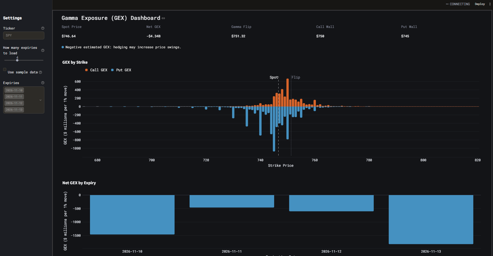

# GEX dashboard

A fun dashboard that estimates gamma exposure (GEX): how much stock options market makers ("dealers") need to buy or sell to stay hedged as the price moves. It pulls live option chains, computes Black-Scholes gamma for every contract, and shows where dealer hedging is likely to calm the market and where it's likely to make moves bigger.



## What it shows

- **Net GEX:** total dollars of stock dealers would trade for a 1% move
- **Gamma flip:** the price where net GEX switches from negative to positive
- **Call wall / put wall:** the strikes with the most call and put GEX, which often act as soft resistance and support
- **GEX by strike** and **GEX by expiry** charts, with a filter for which expiries to include

## Run it

```bash
python -m venv .venv
.venv\Scripts\activate            # mac/linux: source .venv/bin/activate
pip install -r requirements.txt
streamlit run app.py
```

- Nobody can see who is actually long or short each option, so the call/put sign rule is a simplification that's often wrong
- This project was for fun & personal use
- Open interest updates once a day, so same-day trades, including 0DTE options, are mostly missing.
- Yahoo Finance data is delayed and sometimes patchy.
- An estimate of where hedging pressure might be, not a trading signal.
